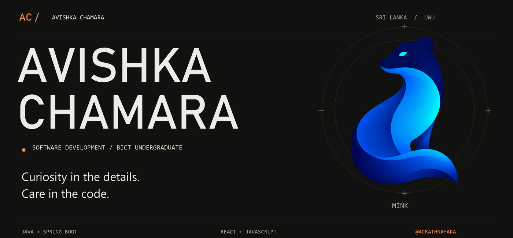
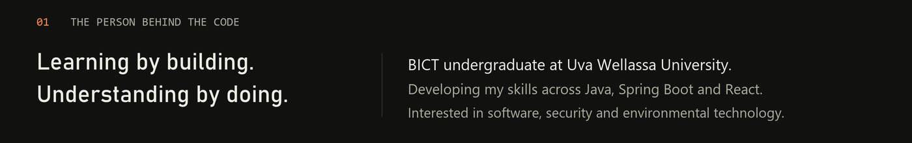
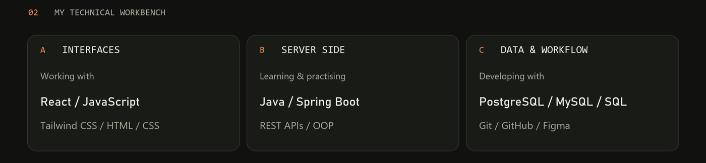
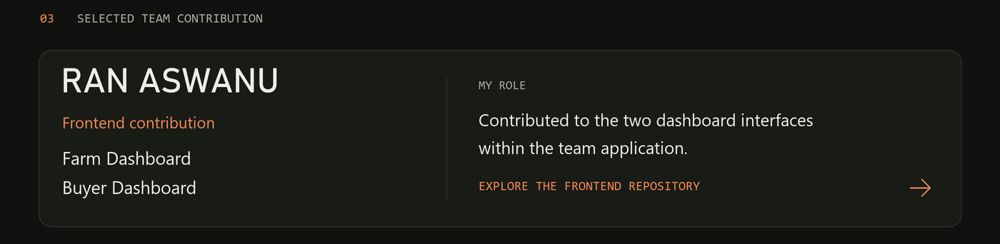
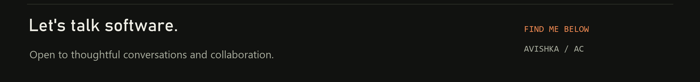
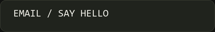

<!-- Custom profile artwork with supplied MINK logo. Upload README.md and assets/ together. -->

<!-- Add future completed projects here, keeping each contribution accurately scoped. -->

Profile in text / contact details

# Avishka Chamara

BICT undergraduate at Uva Wellassa University, Sri Lanka.

I'm developing my skills in Java, Spring Boot and React. I learn by writing code, investigating bugs and understanding the decisions behind a solution. My interests include software engineering, cybersecurity and technology for environmental problems.

**Frontend:** JavaScript, React, HTML, CSS, Tailwind CSS.  
**Backend learning:** Java, Spring Boot, REST APIs, OOP.  
**Database learning:** SQL, PostgreSQL, MySQL.  
**Tools:** Git, GitHub, IntelliJ IDEA, Figma.

## Ran Aswanu - team contribution

Contributed to the Farm Dashboard and Buyer Dashboard frontend interfaces. The wider application was a team effort.

[Frontend repository](https://github.com/rukshan-premathilaka/ran-aswanu-client)

## Contact

[LinkedIn](https://www.linkedin.com/in/avishka-chamara-b3813b3ab)  
[avishkacrathnayaka@gmail.com](mailto:avishkacrathnayaka@gmail.com)  
Alternative: [avishkachamara71@gmail.com](mailto:avishkachamara71@gmail.com)

