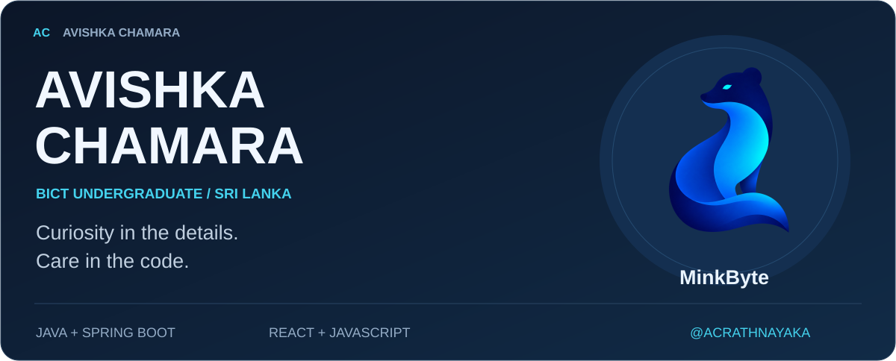

<!-- Only the first header is an image. Everything below it is native Markdown/HTML text. -->

 

## About me

### Learning with purpose. Building with care.

I'm a **BICT undergraduate at Uva Wellassa University, Sri Lanka**, developing my skills in **Java, Spring Boot and React**.

I learn by writing code, investigating bugs and understanding the decisions behind a solution.

> **My interests**  
> Software engineering · Cybersecurity · Environmental technology

 

## My workbench

### Frontend
*Building interfaces*

`React` &nbsp; `JavaScript` &nbsp; `HTML` &nbsp; `CSS` &nbsp; `Tailwind CSS`

### Backend
*Currently learning*

`Java` &nbsp; `Spring Boot` &nbsp; `REST APIs` &nbsp; `OOP`

### Databases
*Currently learning*

`SQL` &nbsp; `PostgreSQL` &nbsp; `MySQL`

### Developer tools
*My everyday toolkit*

`Git` &nbsp; `GitHub` &nbsp; `IntelliJ IDEA` &nbsp; `Figma`

 

## Selected work

<blockquote>
<a href="https://github.com/rukshan-premathilaka/ran-aswanu-client">
<strong>Ran Aswanu</strong> 
TEAM PROJECT · FRONTEND CONTRIBUTION  
Technology for agriculture. 
An agricultural platform built by our team.  
<strong>My contribution</strong> 
Farm Dashboard and Buyer Dashboard frontend interfaces.  
<strong>Explore the repository →</strong>
</a>
</blockquote>

<a href="https://ran-aswanu-client.vercel.app/"><kbd>　 Visit live website ↗ 　</kbd></a>

 

## Let's talk software

Open to thoughtful conversations and collaboration.

<a href="https://www.linkedin.com/in/avishka-chamara-b3813b3ab"><kbd>　 LinkedIn ↗ 　</kbd></a>
&nbsp;&nbsp;
<a href="https://github.com/ACRATHNAYAKA?tab=repositories"><kbd>　 GitHub repositories ↗ 　</kbd></a>

